# DoxyPas — User guide

[Português](../pt/GUIA_DO_UTILIZADOR.md) · [Options reference](OPTIONS.md) · [README](../../README.md)

DoxyPas writes the documentation of **Object Pascal** programs (Delphi, Free Pascal, Lazarus) from the source files and
from the comments in them. It is written in Delphi, works like [Doxygen](https://github.com/doxygen/doxygen) (same
Doxyfile, same comment commands, same look) and understands Pascal: units, classes, records, interfaces, helpers, generics,
routines, properties, enumerations and the forms (`.dfm`, `.fmx`).

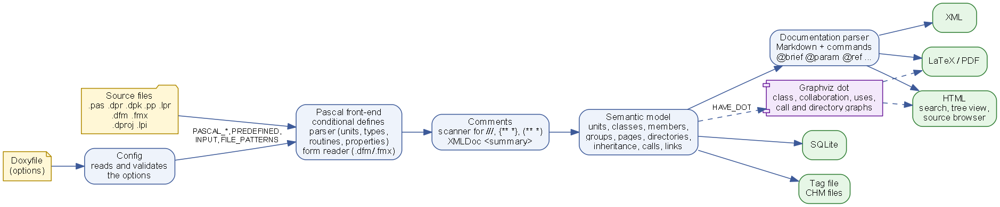

*The Doxyfile (options) and the sources go in; the comments are read, joined to the declarations in a model of the
program, and written as HTML, LaTeX/PDF, XML, SQLite, a tag file or CHM. The graphs are drawn by Graphviz `dot`.*

## Contents

1. [Quick start](#1-quick-start)
2. [Command line](#2-command-line)
3. [The Doxyfile](#3-the-doxyfile)
4. [Writing the comments](#4-writing-the-comments)
5. [The HTML output, page by page](#5-the-html-output-page-by-page)
6. [Graphs](#6-graphs)
7. [Forms, projects and conditional compilation](#7-forms-projects-and-conditional-compilation)
8. [The other outputs](#8-the-other-outputs)
9. [The graphical interface](#9-the-graphical-interface)
10. [Recipes](#10-recipes)
11. [Problems](#11-problems)
12. [Building the project and regenerating the images](#12-building-the-project-and-regenerating-the-images)

## 1. Quick start

You need `DoxyPas.exe` (see [building](#12-building-the-project-and-regenerating-the-images)) and, to have the graphs,
[Graphviz](https://graphviz.org/) (`dot`) on the `PATH`.

```
doxypas -g Doxyfile        # writes a Doxyfile with all the options and their documentation
                           # edit it: at least PROJECT_NAME, INPUT, RECURSIVE
doxypas Doxyfile           # writes the documentation
```

The folder [`docs/example`](../example) is a small project with its Doxyfile; every image of this guide was made from it:

```
cd docs\example
doxypas Doxyfile           # writes docs\example\out\html\index.html
```

The Doxyfile of the example is short, because the options that are not written have their default (see the
[reference](OPTIONS.md)):

```
PROJECT_NAME      = "Geometry"
PROJECT_NUMBER    = 1.0
PROJECT_BRIEF     = "Shapes and measures"
INPUT             = src
USE_MDFILE_AS_MAINPAGE = README.md
OUTPUT_DIRECTORY  = out
GENERATE_LATEX    = NO
HAVE_DOT          = YES
SOURCE_BROWSER    = YES
```

The result, opened in a browser (`out\html\index.html`):

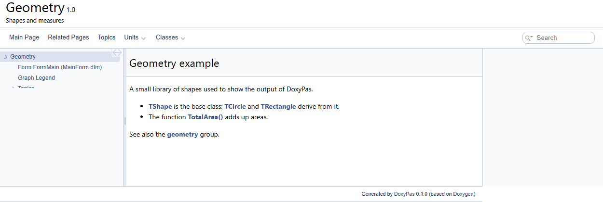

The title and the one-line description come from `PROJECT_NAME`, `PROJECT_NUMBER` and `PROJECT_BRIEF`; the text of the
page is the `README.md` (`USE_MDFILE_AS_MAINPAGE`).

## 2. Command line

| Command | What it does |
|---|---|
| `doxypas [Doxyfile]` | Reads the configuration (default `Doxyfile`) and writes the documentation. |
| `doxypas -g [Doxyfile]` | Writes a Doxyfile with all the options and a comment that explains each one. `-` writes to the screen. |
| `doxypas -s -g [Doxyfile]` | The same without the comments. |
| `doxypas -u [Doxyfile]` | Updates an old Doxyfile to this version (adds new options, removes the obsolete ones). `-s` also removes the comments. |
| `doxypas -x [Doxyfile]` | Shows only the options that are different from the default. |
| `doxypas -l [Layout.xml]` | Writes the layout file (default `DoxygenLayout.xml`) that you can edit and give to `LAYOUT_FILE`. |
| `doxypas -v` / `-h` | Version / help. |

Developer commands: `--parse <path>` (dumps what the parser read), `--model <path>` (dumps the model) and `--doc <file>`
(runs the Markdown and comment parser on a text file).

The exit code is non-zero if the run failed; with `WARN_AS_ERROR = FAIL_ON_WARNINGS` it is also non-zero when there were
warnings, which is what a continuous-integration build wants.

## 3. The Doxyfile

A Doxyfile is a text file of lines `OPTION = value`:

```
# a comment
PROJECT_NAME  = "My Library"          # a value with spaces needs quotes
RECURSIVE     = YES                   # YES / NO
INPUT         = src tests\helpers     # a list: values separated by spaces
EXCLUDE      += src\old               # += adds to a list
OUTPUT_DIRECTORY = $(DOCS_DIR)        # environment variables
@INCLUDE      = common.cfg            # another file
```

* The names are case sensitive and in capitals. If an option is written twice, the last one wins.
* A long line can be continued with `\` at the end.
* There are **221 options**, in 14 groups. The [reference](OPTIONS.md) explains each one:

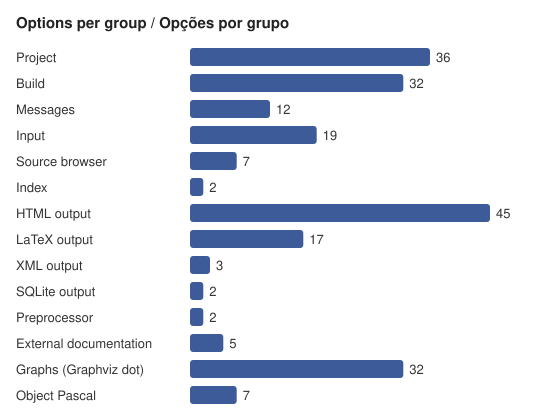

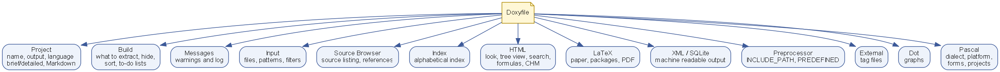

The first options to change in a new project:

| Option | Why |
|---|---|
| `PROJECT_NAME`, `PROJECT_NUMBER`, `PROJECT_BRIEF`, `PROJECT_LOGO` | Identify the documentation. |
| `INPUT`, `RECURSIVE`, `FILE_PATTERNS`, `EXCLUDE_PATTERNS` | Which files. |
| `DELPHI_PROJECT` | Take the files and the defines from a `.dproj` / `.lpi`. |
| `EXTRACT_ALL` | Document also what has no comment (first run on an old project). |
| `EXTRACT_PRIVATE`, `EXTRACT_STATIC` | Include the private members and the `implementation` section. |
| `HAVE_DOT` | Draw the graphs. |
| `SOURCE_BROWSER` | Add the listing of the sources. |
| `OUTPUT_LANGUAGE`, `GENERATE_LATEX`, `GENERATE_XML` | Language and formats. |

## 4. Writing the comments

DoxyPas reads comments that start in a special way ("documentation comments") and joins each one to the declaration that
**follows** it (or that **precedes** it, with `<`).

| Style | Example |
|---|---|
| Line | `/// Brief description.` (several lines in a row are one comment) |
| Block (Javadoc) | `{** Brief. More text. }` or `(** ... *)` |
| After the declaration | `FName: string; //!< the name` or `{!< the name }` |
| XMLDoc (Delphi) | `/// <summary>Brief.</summary>` — with `PASCAL_XMLDOC = YES`, the default |

The first sentence is the *brief* description (it is shown in the lists); the rest is the *detailed* description. The text can
use Markdown (`**bold**`, lists, `` `code` ``, tables), HTML and the Doxygen commands that start with `\` or `@`.

The unit of the example, [`Shapes.pas`](../example/src/Shapes.pas):

```pascal
{** \file Shapes.pas
    Base types of the geometry library: the shape hierarchy and the drawing interface. }
unit Shapes;

{** \defgroup geometry Geometry
    Shapes and measures. }

interface
type
  /// Something that can paint itself.
  IDrawable = interface
    ['{6F1B3C52-8A0E-4C57-9D55-3B7B0C2D1A10}']
    /// Paints the object on the canvas.
    /// \param ACanvasName name of the canvas to paint on
    procedure Draw(const ACanvasName: string);
  end;

  /// <summary>Base class of all shapes.</summary>
  /// <remarks>Descendants override <see cref="Area"/> and <see cref="Perimeter"/>.</remarks>
  /// \ingroup geometry
  TShape = class(TInterfacedObject, IDrawable)
  public
    /// Creates a shape with a name.
    /// \param AName the name shown in the lists
    constructor Create(const AName: string);
    /// Area of the shape.
    /// \return the area in square units
    function Area: Double; virtual; abstract;
    /// The name of the shape.
    property Name: string read FName write FName;
  end;
```

The commands that are used most:

| Command | Meaning |
|---|---|
| `\brief text` | The brief description (not needed when the first sentence is the brief one: `JAVADOC_AUTOBRIEF`). |
| `\param Name text` | Describes a parameter. `\param[in]`, `[out]`, `[in,out]` give the direction. |
| `\return text` | Describes the result of a function. |
| `\sa Name`, `\ref Name` | "See also" and a link to another entity or page. |
| `\see`, `\note`, `\warning`, `\remark`, `\attention` | Highlighted paragraphs. |
| `\todo`, `\bug`, `\test`, `\deprecated` | Add the item to the list pages of the whole project. |
| `\defgroup id Title`, `\ingroup id`, `\addtogroup` | Groups ("Topics" in the menu). |
| `\mainpage`, `\page id Title`, `\section`, `\subsection` | Free pages and their sections. |
| `\copydoc Name`, `\copybrief`, `\copydetails`, `\inheritdoc` | Reuse the documentation of another entity. |
| `\code ... \endcode`, `\snippet`, `\include` | Code in the text (or from a file of `EXAMPLE_PATH`). |
| `\image html file.png "caption"` | An image (searched in `IMAGE_PATH`). |
| `\dot ... \enddot` | A graph written in the comment (needs `dot`). |
| `\if label ... \endif`, `\cond` | Conditional parts (`ENABLED_SECTIONS`). |
| `\cite key` | A reference of a `.bib` file (`CITE_BIB_FILES`). |

The complete list of commands is the one of Doxygen; the ones that DoxyPas does not know are shown as text and give a warning.
Your own commands can be made with `ALIASES`.

A documented element gets, from the unit above, this page:

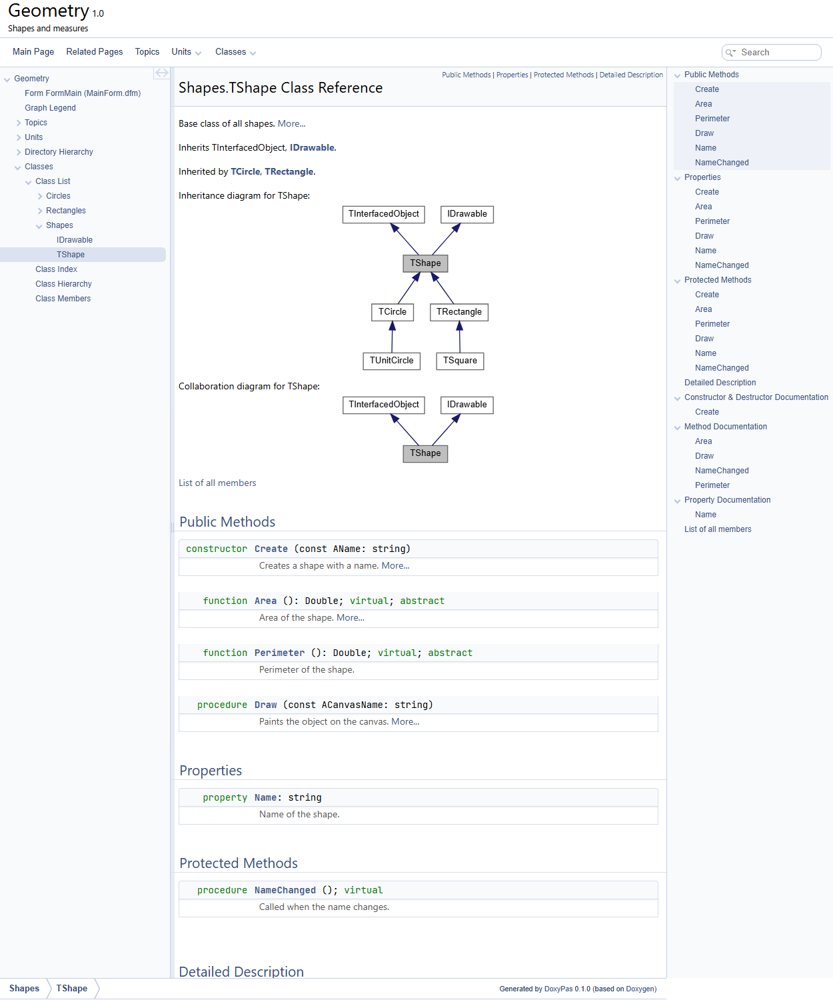

The brief description is in the lists at the top, the detailed one and the `\param` / `\return` further down. The
visibility sections use the words of Pascal (*Public Methods*, *Protected Methods*, *Properties*...) and the right panel is the
outline of the page.

### What is not documented

With the defaults, an element without a comment is shown in the lists but gets no detailed section, and `WARN_IF_UNDOCUMENTED = YES`
gives a warning for it:

```
src\Shapes.pas:30: warning: field Shapes.TShape.FName is not documented.
```

Use `HIDE_UNDOC_MEMBERS`, `HIDE_UNDOC_CLASSES` to hide them, or `EXTRACT_ALL = YES` to accept them. Private members are not
shown unless `EXTRACT_PRIVATE = YES`:

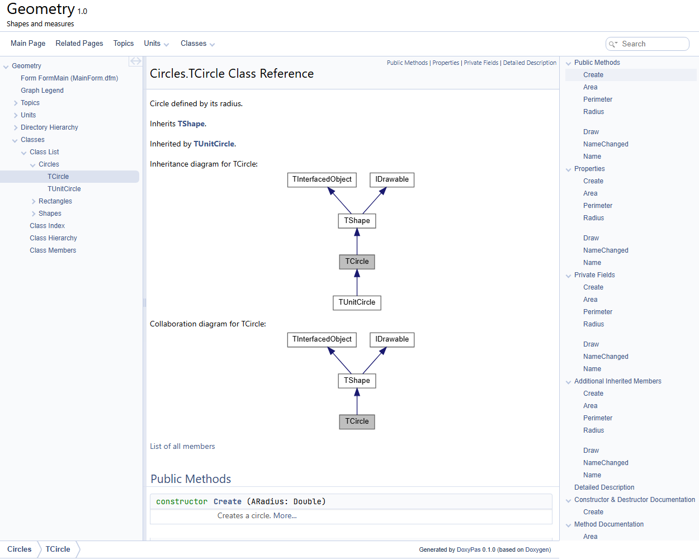

## 5. The HTML output, page by page

Open `index.html`. The pages are:

| Page | Content |
|---|---|
| Main Page | `\mainpage`, or the Markdown file of `USE_MDFILE_AS_MAINPAGE`. |
| Related Pages | The `\page` pages, the lists of todo / bugs / deprecated, the legend of the graphs. |
| Topics | The groups (`\defgroup`). |
| Units | The units with their classes, types, constants and routines; the "Uses" and the dependency graph. |
| Classes | The class list, the **class index** (alphabetical, `ALPHABETICAL_INDEX`), the **hierarchy** and all the members. |
| Files | The files and the folders (*Directory Hierarchy*), with the graph of the folders. |
| Forms | One page for each `.dfm` / `.fmx`, with the tree of components. |

A unit, with its dependency graph, constants and routines:

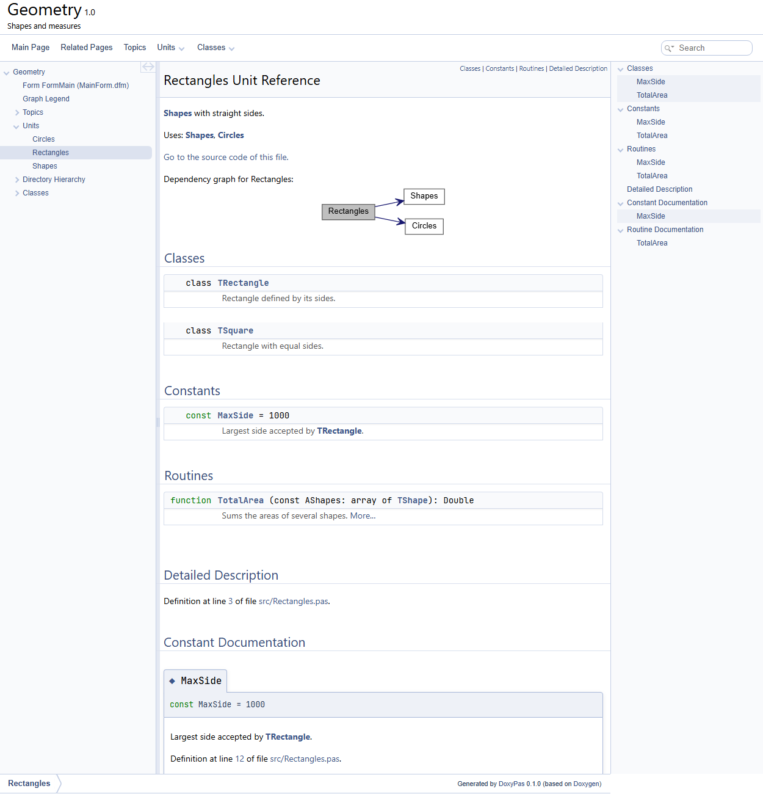

The class hierarchy (an interface at the top, the classes below):

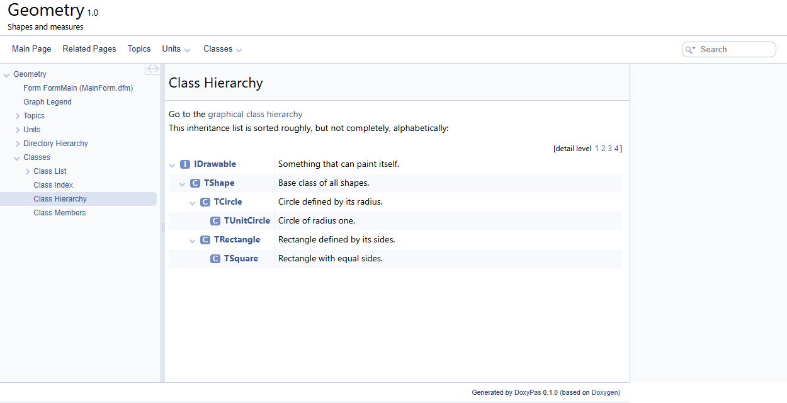

With `SOURCE_BROWSER = YES` every unit has a source page; the names are links to the documentation and can be folded
(`HTML_CODE_FOLDING`):

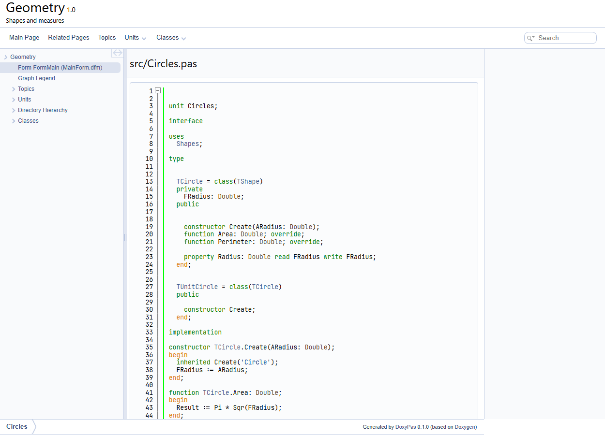

`INLINE_SOURCES = YES` shows the body of each routine in its documentation:

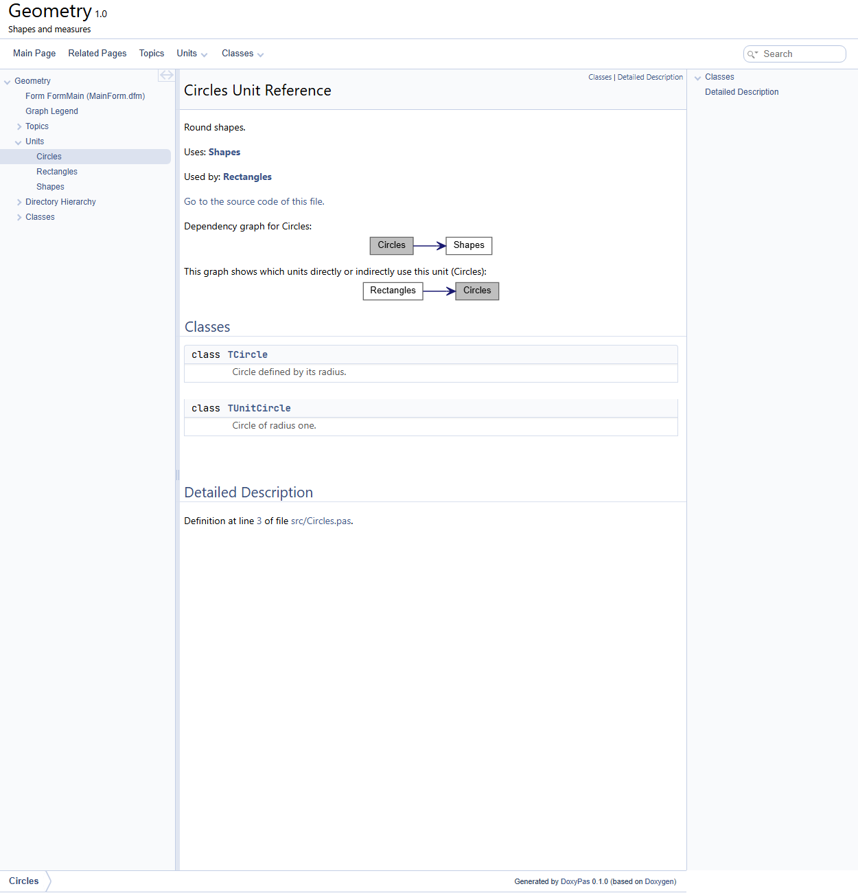

The search box (`SEARCHENGINE`) works in the browser, without a server. The panel at the left is
`GENERATE_TREEVIEW`; the one at the right is `PAGE_OUTLINE_PANEL`.

### The look

* **Colors:** `HTML_COLORSTYLE` (`LIGHT`, `DARK`, `AUTO_LIGHT`, `AUTO_DARK`, `TOGGLE`) and `HTML_COLORSTYLE_HUE`.

  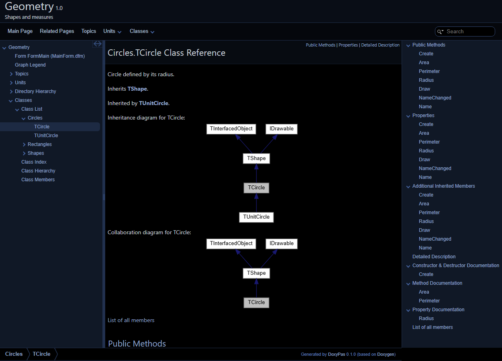

  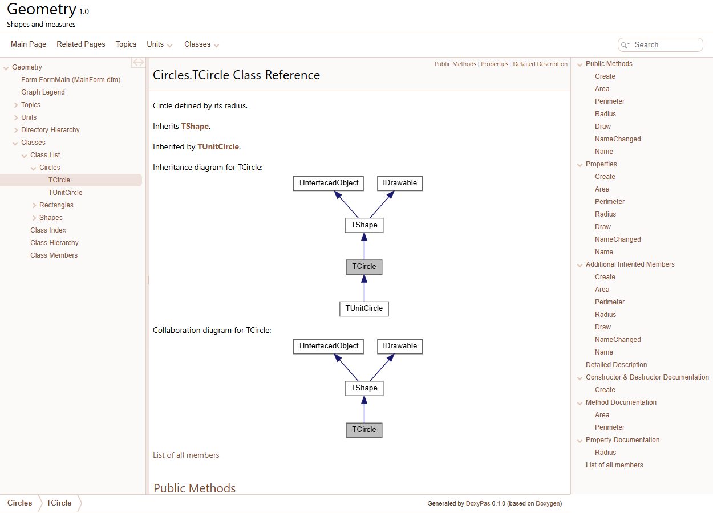

* **Layout:** `FULL_SIDEBAR`, `GENERATE_TREEVIEW`, `DISABLE_INDEX`, `LAYOUT_FILE`.

  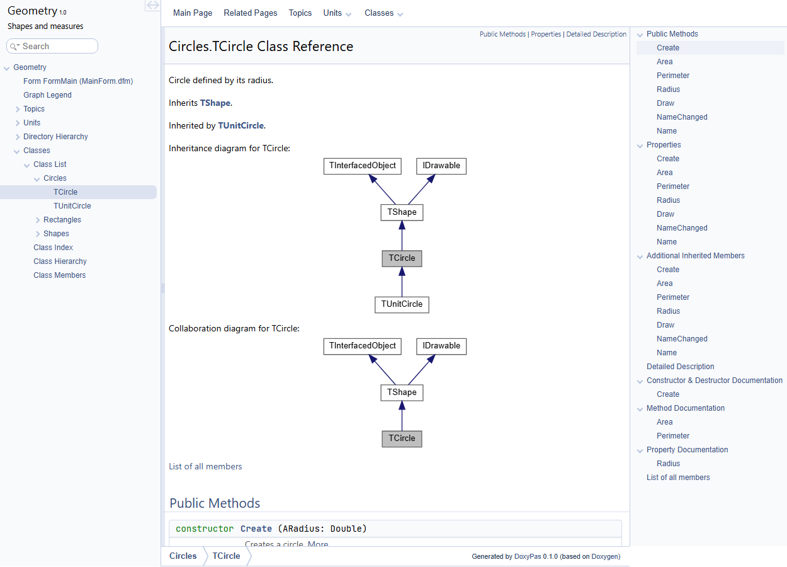

  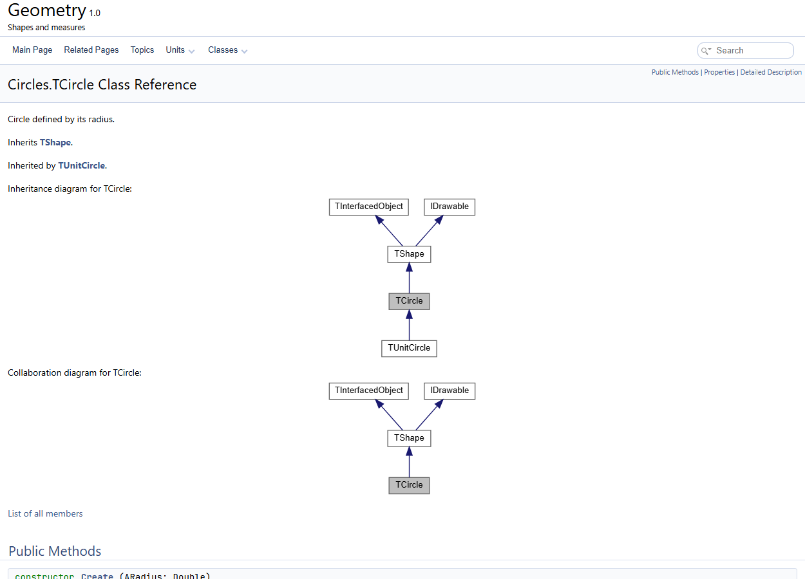

* **Your own files:** `HTML_HEADER`, `HTML_FOOTER`, `HTML_EXTRA_STYLESHEET`, `HTML_EXTRA_FILES`. Start from
  `resources\html\header.html` and `footer.html`.
* **Language of the fixed texts:** `OUTPUT_LANGUAGE`.

  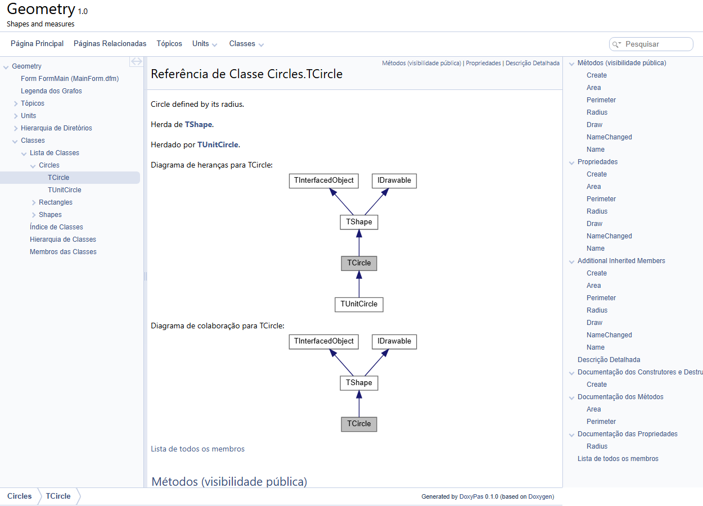

## 6. Graphs

With `HAVE_DOT = YES` (and Graphviz installed, or `DOT_PATH` set) DoxyPas draws:

| Graph | Option | Where |
|---|---|---|
| Inheritance (ancestors and descendants) | `CLASS_GRAPH` | Page of the class. |
| Collaboration (what the class refers to) | `COLLABORATION_GRAPH` | Page of the class. |
| `uses` of a unit / units that use it | `INCLUDE_GRAPH` / `INCLUDED_BY_GRAPH` | Page of the unit. |
| Calls of a routine / who calls it | `CALL_GRAPH` / `CALLER_GRAPH` | Page of the unit or class (off by default: slow). |
| Dependencies between folders | `DIRECTORY_GRAPH`, `DIR_GRAPH_MAX_DEPTH` | Page of the folder. |
| Dependencies between groups | `GROUP_GRAPHS` | Page of the group. |
| Hierarchy of all classes | `GRAPHICAL_HIERARCHY` | "Graphical class hierarchy". |

The default image is SVG: it stays sharp when zoomed and **the boxes are links**. `INTERACTIVE_SVG = YES` adds zoom and
move with the mouse. `DOT_IMAGE_FORMAT = png` makes bitmaps without links.

The class graphs of `TShape` (it is the one in the picture of the class page above) show the ancestors above and the
descendants below. The same with `UML_LOOK = YES` and `DOT_UML_DETAILS = YES`:

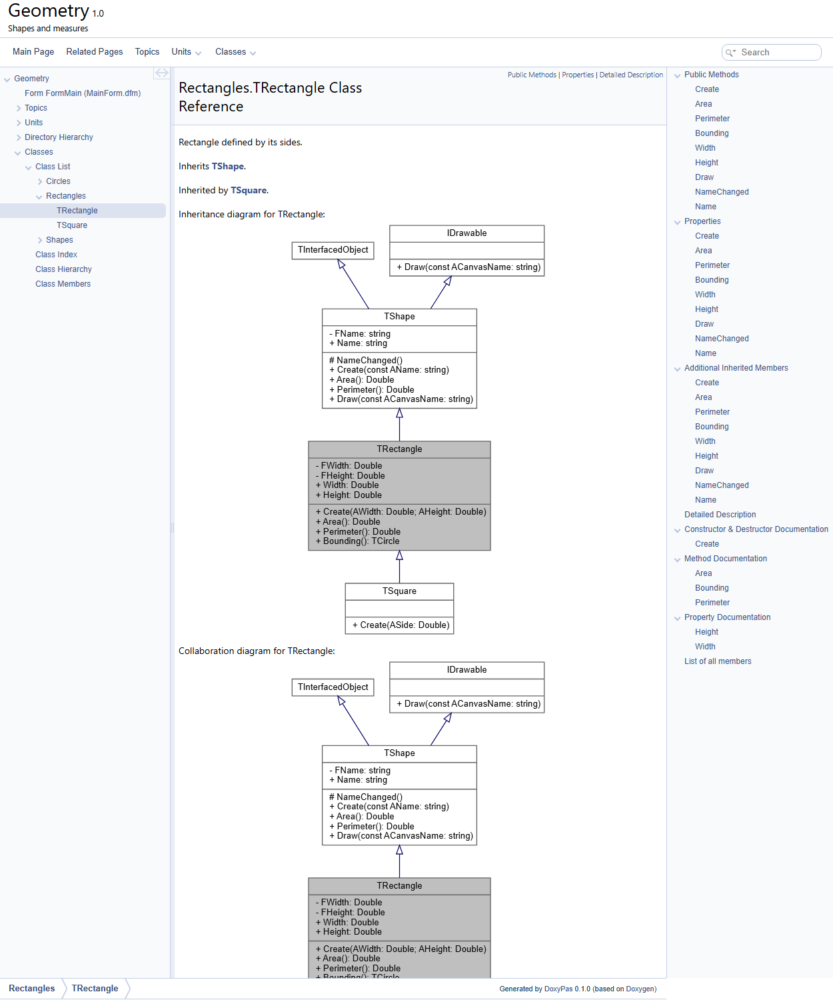

Without `dot` (`HAVE_DOT = NO`) the inheritance diagram is still drawn by DoxyPas, but the other graphs are not:

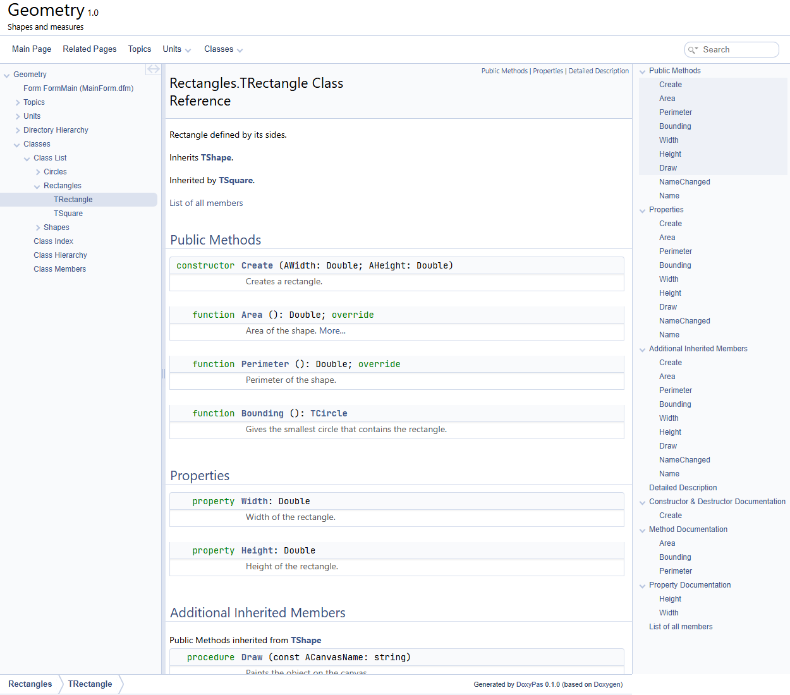

The graph of the routines that `TRectangle.Bounding` calls (`CALL_GRAPH`) and the one of who calls `TCircle.Create`
(`CALLER_GRAPH`):

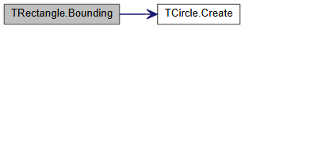 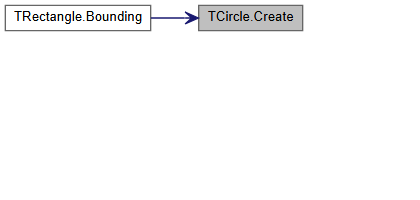

To make big graphs smaller use `DOT_GRAPH_MAX_NODES`, `MAX_DOT_GRAPH_DEPTH` and `HIDE_UNDOC_RELATIONS`. To change the
fonts, colors and shapes use `DOT_COMMON_ATTR`, `DOT_NODE_ATTR` and `DOT_EDGE_ATTR`.

You can also draw your own graph in a comment:

```pascal
/// \dot
///   digraph G { Client -> Server -> Database }
/// \enddot
```

## 7. Forms, projects and conditional compilation

**Forms.** With `PASCAL_PARSE_DFM = YES` each `.dfm` / `.fmx` (text or binary) becomes a page with the tree of components
(class, name, caption) and the event handlers (`OnClick = ButtonAreaClick`). With
`PASCAL_DFM_PROPERTIES = YES` it also lists the values of the properties.

**Projects.** `DELPHI_PROJECT = MyApp.dproj` takes the files, the search paths and the conditional defines from the
project (`.dpr`, `.dpk`, `.dproj`, `.groupproj`, and Lazarus `.lpi`, `.lpk`). Several can be listed.

**Conditional compilation.** The code between `{$IFDEF}` / `{$ENDIF}` is the code the compiler would see:

| Option | Role |
|---|---|
| `PASCAL_DIALECT` | `Delphi` or `FPC`: defines `DELPHI` or `FPC`, and the language mode. |
| `PASCAL_PLATFORM` | `Win32`, `Win64`, `Linux64`, `macOS`, `iOS`, `Android`: defines `MSWINDOWS`, `LINUX`, `CPUX64`... |
| `PREDEFINED` | Your own symbols (`DEBUG USE_SSL`). |
| `INCLUDE_PATH` | Where `{$I file.inc}` is searched. |
| `PASCAL_UNIT_SCOPES` | The unit scope names, so that `Classes` is found as `System.Classes`. |

To document the Linux version of a library: `PASCAL_PLATFORM = Linux64`.

**Encodings.** Old Delphi sources are in ANSI. DoxyPas reads a file that is not valid UTF-8 in the ANSI code page of the
system; for other cases use `INPUT_ENCODING` or `INPUT_FILE_ENCODING = *.pas=windows-1250`.

## 8. The other outputs

| Output | Option | Result |
|---|---|---|
| HTML | `GENERATE_HTML` (default) | `html\index.html` |
| LaTeX / PDF | `GENERATE_LATEX` | `latex\refman.tex`, `Makefile`, `make.bat`. In that folder run `make.bat` (or `pdflatex refman` twice, plus `makeindex`) with a LaTeX installation (MiKTeX, TeX Live). |
| XML | `GENERATE_XML` | `xml\index.xml` and one file per unit, class and page, with the `.xsd` schemas; `XML_PROGRAMLISTING` adds the code. For your own tools. |
| SQLite | `GENERATE_SQLITE3` | `sqlite3\doxygen_sqlite3.sql`: a script that creates the tables; load it with the `sqlite3` program and query the symbols with SQL. |
| Tag file | `GENERATE_TAGFILE = name.tag` | The list of the symbols, so that another project can link to this one with `TAGFILES = name.tag=../path/html`. |
| CHM | `GENERATE_HTMLHELP`, `CHM_FILE`, `HHC_LOCATION` | The project files of HTML Help; with `HHC_LOCATION` the compiler is run. Turn `SEARCHENGINE` off. |

## 9. The graphical interface

`DoxyPasGui.exe` (Windows) edits a Doxyfile without writing it by hand:

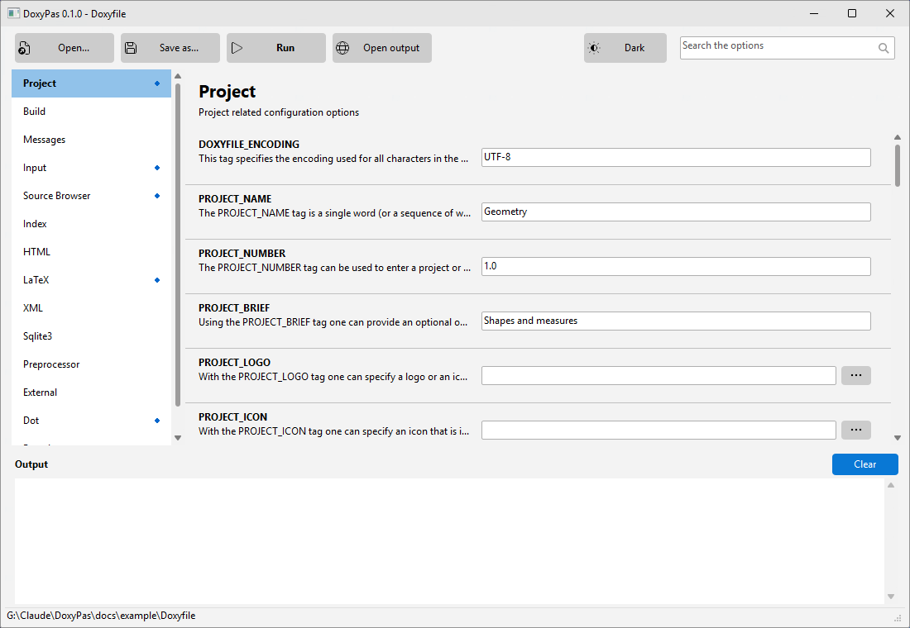

* **Left:** the groups of options. A blue dot marks a group that has options that are not the default.
* **Center:** the options of the group. The name and the description are in the left; the value is a switch (YES/NO),
  a list of choices, a number or a text, with a `...` button to choose a file or a folder. Hover on a name to see the
  full explanation.
* **Search the options** (top right): searches the names and descriptions of all the options.
* **Open...** / **Save as...:** the Doxyfile. The title shows `*` when there are changes that are not saved.
* **Run:** runs `DoxyPas.exe` (it must be in the same folder) with the file and shows its messages in **Output**; the
  button becomes **Stop** while it runs. **Open output** opens the result in the browser.
* **Dark / Light:** the theme of the window.

`DoxyPasGui.exe Doxyfile /run` opens the file and runs it at once.

## 10. Recipes

**An old project with no documentation.** Get a first result and the list of what is missing:

```
EXTRACT_ALL     = YES
RECURSIVE       = YES
SOURCE_BROWSER  = YES
HAVE_DOT        = YES
```

**A library to publish.** Only what is public, with warnings that fail the build:

```
EXTRACT_ALL           = NO
HIDE_UNDOC_MEMBERS    = YES
WARN_IF_UNDOCUMENTED  = YES
WARN_AS_ERROR         = FAIL_ON_WARNINGS
HTML_COLORSTYLE       = TOGGLE
SITEMAP_URL           = https://example.com/mylib/
```

**Documentation for the maintainers.** Everything, with the code and the call graphs:

```
EXTRACT_ALL           = YES
EXTRACT_PRIVATE       = YES
EXTRACT_STATIC        = YES
INTERNAL_DOCS         = YES
SOURCE_BROWSER        = YES
REFERENCES_RELATION   = YES
REFERENCED_BY_RELATION = YES
CALL_GRAPH            = YES
CALLER_GRAPH          = YES
```

**Faster runs on a big project.** `CALL_GRAPH = NO`, `DOT_GRAPH_MAX_NODES = 30`, `MAX_DOT_GRAPH_DEPTH = 2`,
`SOURCE_TOOLTIPS = NO`, `CREATE_SUBDIRS = YES`, `NUM_PROC_THREADS = 0`, `DOT_NUM_THREADS = 0`.

**Link two projects.** In the library: `GENERATE_TAGFILE = lib.tag`. In the application:
`TAGFILES = ..\lib\lib.tag=..\..\lib\html`.

**A PDF.** `GENERATE_LATEX = YES`, `GENERATE_HTML = NO`, `PAPER_TYPE = a4`, then run `make.bat` in `latex\`.

## 11. Problems

| Symptom | Cause and solution |
|---|---|
| No graphs, only the inheritance diagram | `HAVE_DOT = NO`, or `dot` is not found: install Graphviz and add it to the `PATH`, or set `DOT_PATH`. |
| `warning: ... is not documented` for everything | Normal without comments. Use `EXTRACT_ALL = YES` or `WARN_IF_UNDOCUMENTED = NO`. |
| A file is not read | Its extension is not in `FILE_PATTERNS`, it is in `EXCLUDE` / `EXCLUDE_PATTERNS`, or `RECURSIVE = NO` and it is in a sub-folder. |
| `error: 'SemiColon' expected` in a file | The file is not Pascal (a `.md` in `INPUT`: use `USE_MDFILE_AS_MAINPAGE` instead) or the conditional defines are wrong: set `PASCAL_PLATFORM`, `PREDEFINED`, `DELPHI_PROJECT`. |
| Accents are wrong | The file is not in the encoding that is expected: set `INPUT_ENCODING`. |
| A `{$I file.inc}` is not found | Add its folder to `INCLUDE_PATH`. |
| The class of another unit is not a link | The unit is not in `INPUT`; use `TAGFILES` if it is documented elsewhere. |
| An option has no effect | Check the spelling (case matters) and `doxypas -x Doxyfile`: it lists what the file sets. A line with an unknown option gives a warning. |

## 12. Building the project and regenerating the images

Delphi 13 (RAD Studio 37.0):

```
build.bat            # DoxyPas for Win32, Win64, Linux64 and the GUI for Win32, Win64
build.bat test       # builds and runs the DUnitX tests
build.bat gen        # regenerates the options and the resources
```

The documentation in this folder is made by two scripts, so that it can be refreshed after a change:

```
python tools\docs\gen_options.py              # docs\en\OPTIONS.md, docs\pt\OPCOES.md and the bar charts
powershell tools\docs\make_images.ps1         # the screenshots of the HTML (needs Chrome and Graphviz)
powershell tools\docs\shot_gui.ps1            # the screenshot of the GUI
```

`gen_options.py` stops if an option of the Doxyfile has no text in `tools\docs\options_text.py` (or the other way
round): a new option cannot be forgotten. The diagrams `docs\images\pipeline.png` and `structure.png` are made from the
`.dot` files next to them (`dot -Tpng -Gdpi=110 pipeline.dot -o pipeline.png`).
